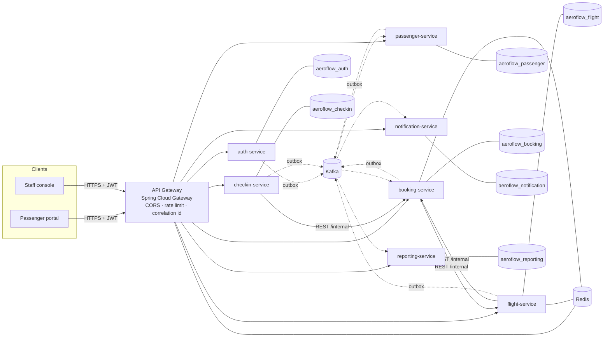
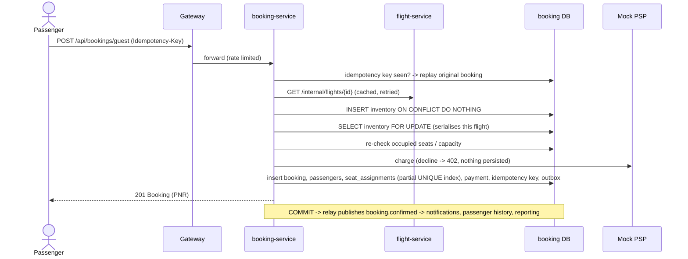
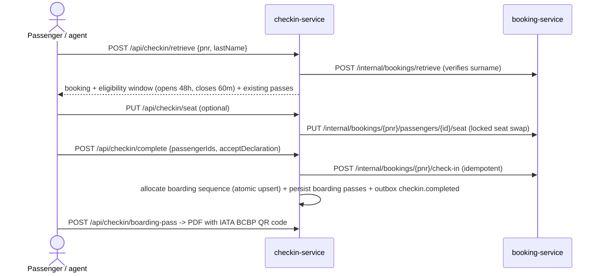

# AeroFlow — Architecture

AeroFlow is an airline operations and passenger platform built as **8 Spring Boot microservices** behind an
API gateway, with a React SPA serving two experiences (staff console and passenger portal).

## System architecture



| Service | Owns | Sync dependencies | Publishes | Consumes |
|---|---|---|---|---|
| gateway | routing, CORS, rate limits | all services | — | — |
| auth-service | users, roles, refresh tokens | — | `user.registered`, audit | — |
| flight-service | airports, fleet, flights, status | booking (booking count before delete) | `flight.*`, audit | — |
| passenger-service | profiles, travel-history read model | — | audit | `user.*`, `booking.*`, `checkin.*` |
| booking-service | bookings, seat inventory, payments, idempotency keys | flight (authoritative flight data) | `booking.*` | `flight.status-changed`, `flight.updated` |
| checkin-service | check-ins, boarding passes | booking (retrieve, seat change, mark checked-in) | `checkin.completed` | — |
| notification-service | notification log | — | — | `booking.*`, `checkin.*` |
| reporting-service | reporting read model, audit log | — | — | all topics |

## Communication

```mermaid
sequenceDiagram
  participant S as Service (e.g. booking)
  participant DB as Service DB
  participant R as OutboxRelay (@Scheduled)
  participant K as Kafka
  participant C as Consumer service
  S->>DB: BEGIN; write booking + INSERT outbox_events; COMMIT
  loop every 1s
    R->>DB: SELECT … FOR UPDATE SKIP LOCKED (pending)
    R->>K: send(topic, key=aggregateId, envelope)
    R->>DB: mark published_at
  end
  K->>C: deliver (at-least-once)
  C->>C: EventInbox.firstDelivery(eventId)? (processed_events PK)
  C->>C: apply change in same transaction
```

* **Synchronous (REST)** only where a caller needs an authoritative answer *now* (flight fare/status at booking time,
  booking lookup at check-in). Internal calls hit `/internal/**`, require a short-lived service JWT (`ROLE_SERVICE`)
  and are blocked at the gateway. Every call has connect/read timeouts, exponential-backoff retry and a circuit
  breaker (Resilience4j); failures surface as `503 UPSTREAM_UNAVAILABLE`.
* **Asynchronous (Kafka)** for everything else. Events use a common envelope
  `{eventId, type, source, aggregateId, occurredAt, payload}` keyed by aggregate id (per-aggregate ordering).
* **Transactional outbox** guarantees no event is lost or published for a rolled-back transaction.
* **Idempotent consumers**: each service records processed event ids; redeliveries are no-ops.
  Poison messages are retried with backoff then parked on `<topic>.DLT`.

## Booking sequence (seat concurrency + idempotency)



Three layers stop double booking: the per-flight row lock, the in-lock availability re-check and the partial unique
index `ux_seat_active (flight_id, seat_number) WHERE released = false`. Verified by a 10-thread race test in
`scripts/smoke_test.py` (exactly one 201, nine 409s).

## Check-in sequence



## Cross-cutting concerns

| Concern | Implementation |
|---|---|
| Errors | `GlobalExceptionHandler` → single `ApiError {timestamp,status,code,message,path,traceId,fieldErrors}` |
| Validation | Bean Validation on every DTO + domain invariants in services/entities |
| AuthN/Z | Stateless JWT (HS256), rotating refresh tokens with reuse detection, `@PreAuthorize` RBAC per endpoint |
| Concurrency | Pessimistic row lock per flight, partial unique index, `@Version` optimistic locking (`If-Match` on flight edits) |
| Idempotency | `Idempotency-Key` header on booking creation (request hash checked), idempotent check-in, inbox de-dup |
| Caching | Redis cache-aside (airports 6h, flight 5m, search 60s, layout 10m) with evict-on-write; cache errors degrade to misses |
| Rate limiting | Redis token bucket at the gateway (auth: 5 rps / burst 20, bookings: 20 rps / burst 60 per IP) + account lockout |
| Observability | Actuator health/readiness/liveness, Micrometer → Prometheus, Grafana dashboard, JSON logs with `traceId` |
| Time | All instants stored UTC (`TIMESTAMPTZ`); search uses the origin airport's IANA timezone |

## Architecture decision records (summary)

1. **Database per service, one Postgres instance** — strong ownership without operational overhead; a schema-per-service
   mode exists for single-database managed plans.
2. **Outbox over dual writes** — avoids lost/phantom events; relay uses `SKIP LOCKED` so it scales horizontally.
3. **Pessimistic lock for seats** — seat inventory is a hot, contended resource where optimistic retries thrash;
   holding one row lock for a short transaction is simple and provably correct, backed by a unique index.
4. **HS256 shared secret** — simplest correct option for a single trust domain; upgrade path is RS256 + JWKS from auth-service.
5. **Read models for history and reporting** — passenger-service and reporting-service build their own projections from
   events instead of querying other services' tables (CQRS-lite).
6. **Gateway terminates CORS and rate limiting** — services stay simple and never see browser preflights.
7. **Mock adapters behind ports** — `PaymentGateway`, `EmailSender`, `SmsSender` interfaces make real providers a drop-in change.
